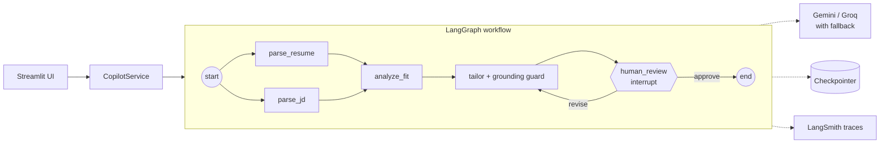

# Job-Hunt Copilot

[](https://github.com/shailender1611/job-hunt-copilot/actions/workflows/ci.yml)


Multi-agent AI copilot that tailors your resume, scores job fit, and drafts cover letters.
Built with **LangGraph**, **LangChain**, **structured output** and **human-in-the-loop** review.

Upload a resume, paste a job description, and the copilot:

1. **Parses both documents** in parallel into typed schemas
2. **Scores your fit**: deterministic keyword coverage plus an LLM assessment of seniority, depth and domain
3. **Finds gaps** and suggests concrete ways to close or reframe them
4. **Drafts** a tailored summary, rewritten resume bullets, a cover letter and a recruiter message
5. **Guards against hallucination**: rewritten bullets must trace back to your resume, invented metrics are flagged
6. **Pauses for your review**: approve, or give feedback and it revises (up to 3 rounds)

## Architecture



## Design decisions

| Decision | Why |
|---|---|
| **LangGraph over a linear chain** | The flow needs parallel branches, a pause for human input and a revise loop, which are first-class in a state graph. |
| **Structured output everywhere** | Every LLM call returns a Pydantic model; no string parsing, and invalid output fails loudly. |
| **Structured output *before* fallbacks** | `with_fallbacks()` hides `with_structured_output()`, so each provider gets the schema first, then they are chained. |
| **Deterministic + LLM scoring** | Keyword coverage is reproducible and explainable; the LLM judges what keywords can't (seniority, equivalents like RabbitMQ for Kafka). |
| **Deterministic grounding guard** | The model is told not to invent facts, and the code checks anyway: unknown bullets are dropped, new numbers are flagged. |
| **Prompt-injection hygiene** | Documents are wrapped in tags and declared untrusted in every system prompt; inputs are size-capped. |
| **Injectable LLM factory** | The whole graph runs in tests with fakes, so CI needs no API keys and costs nothing. |
| **Service layer** | UIs call `start / review / get`; thread ids, interrupts and `Command` stay inside the service. |

## Quickstart

Requires Python 3.11+ and [uv](https://docs.astral.sh/uv/).

```bash
git clone https://github.com/shailender1611/job-hunt-copilot.git
cd job-hunt-copilot
uv sync
cp .env.example .env   # add GOOGLE_API_KEY (free from Google AI Studio)
uv run pytest
uv run streamlit run ui/streamlit_app.py
```

No key in `.env`? The app asks for a Gemini key in the sidebar and uses it only for your session.
Set `GROQ_API_KEY` too and the app automatically falls back to Groq on rate limits.

## Deployment

**Streamlit Community Cloud** (free): New app → this repo → branch `main` → main file
`ui/streamlit_app.py`. Under *Advanced settings → Secrets* add:

```toml
GOOGLE_API_KEY = "..."
GROQ_API_KEY = "..."          # optional fallback
LANGSMITH_TRACING = "true"    # optional
LANGSMITH_API_KEY = "..."
```

**Docker** (Render, Hugging Face Spaces, any VM). The image honours `$PORT`:

```bash
docker build -t job-hunt-copilot .
docker run -p 8501:8501 -e GOOGLE_API_KEY=... job-hunt-copilot
```

`requirements.txt` is generated from `uv.lock` for hosts that don't support uv; CI fails if it drifts.

## Project layout

```
src/copilot/
  config.py          typed settings (pydantic-settings)
  llm/               provider factory: Gemini / Groq, fallback, embeddings
  schemas/           Pydantic models: resume, job, analysis, tailoring, state
  prompts/           versioned system prompts (.md)
  graph/
    builder.py       StateGraph wiring
    skills.py        deterministic skill normalisation and matching
    nodes/           parse_resume, parse_jd, analyze_fit, tailor, human_review
  tools/             document loader (PDF / TXT / MD)
  service.py         CopilotService used by front ends
ui/                  Streamlit app
tests/               unit, integration (full graph with fakes) and headless UI tests
```

## Roadmap

- [x] Project scaffold (uv, ruff, mypy, pytest, typed settings)
- [x] Pluggable LLM provider (Gemini / Groq) with automatic fallback
- [x] Resume parser: PDF/TXT/MD loader + structured extraction
- [x] JD parser: must-have vs nice-to-have skills, seniority, experience
- [x] Fit scoring & skill-gap analysis: LangGraph with parallel parsing
- [x] Tailored resume bullets + cover letter, with a hallucination guard
- [x] Human-in-the-loop approval: LangGraph interrupt, revise loop, checkpointing
- [x] Streamlit UI with review / revise / approve and Markdown export
- [x] CI (lint, mypy, tests, Docker build + boot test) and deployment
- [ ] Company research tool (Tavily)
- [ ] RAG over past achievements
- [ ] FastAPI backend
- [ ] Application tracker (Postgres) and persistent checkpointer
- [ ] Evaluation suite (LLM-as-judge on a fixed JD/resume set)

## License

MIT
